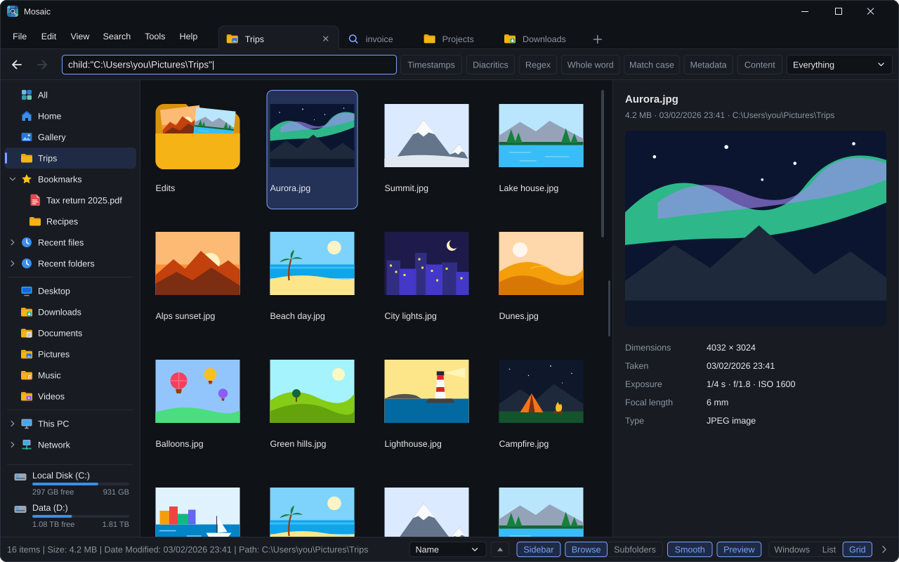
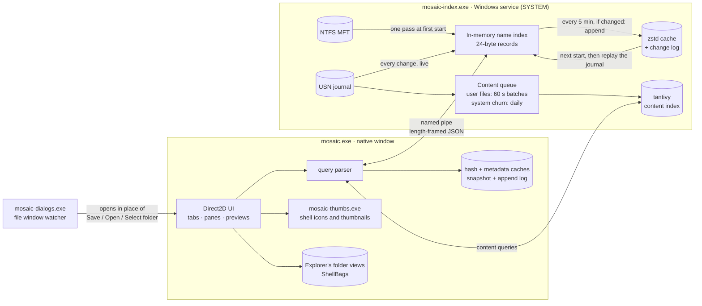

<p align="center">
  
</p>

<p align="center">
  
  
  
  
</p>

<p align="center">
  <b>Mosaic</b> is a file explorer built around a search engine. It reads your NTFS drives straight from the Master File Table,<br>
  keeps up with every change through the USN journal, and answers searches across <b>millions of files in milliseconds</b>.<br>
  Tabs, split panes, previews and full-text search, in a native window with no web view and no Electron.
</p>

<p align="center">
  <a href="#-features">Features</a> ·
  <a href="#-search-language">Search language</a> ·
  <a href="#%EF%B8%8F-keys">Keys</a> ·
  <a href="#%EF%B8%8F-how-it-works">How it works</a> ·
  <a href="#-install">Install</a> ·
  <a href="#%EF%B8%8F-build-from-source">Build</a>
</p>

---

## ⚡ By the numbers

Measured on a Windows 11 PC with a 1 TB NVMe system drive. The times are median round trips to the index service.

| | |
|---:|:---|
| **2,541,861** | files and folders indexed on one drive |
| **≈ 12 ms** | to search and rank all of them for a new query (`win`, folders first) |
| **0.3 ms** | to fetch the next page of results |
| **24 bytes** | per file or folder in the name index |
| **0** | rescans after startup: changes stream in from the USN journal |

<p align="center">
  
  <br><sub><i>Illustration with made-up files</i></sub>
</p>

## ✨ Features

<table>
<tr>
<td width="50%" valign="top">

### 🔎 Search like Everything, then some
- **Instant filename search** across every fixed NTFS drive, live as files change
- Everything-style syntax: `|` OR, `!` NOT, `( )` groups, `"phrases"`, `*` `?` wildcards
- **Regex**, **match case**, **whole word**, **ignore diacritics**, each on one key
- Filters for type, size, dates, attributes, path, folder relations and duplicates
- A **date picker** for modified, created and accessed dates: on, before, after, between, or quick periods like *Last month*
- Right-click any search option for what it does, with examples found and not found

</td>
<td width="50%" valign="top">

### 📄 Full-text content search
- Searches **inside** text, code, Office (`docx` `xlsx` `pptx` `odt`…), **PDF** and legacy Office (via Windows IFilters)
- Powered by [tantivy](https://github.com/quickwit-oss/tantivy), indexed in the background at low priority
- A file you just saved is searchable **at once**: one still waiting for the index is read live at query time
- Lean by design: the first 100,000 words of a file, binary and minified files skipped, the index folder NTFS-compressed
- System and app churn (Windows, ProgramData, AppData) is batched once a day

</td>
</tr>
<tr>
<td valign="top">

### 🗂️ A real file explorer
- **Home**, **All**, **Gallery**, your folders, **This PC**, **Network** and **Linux** (WSL), all inside Mosaic
- USB sticks, shares and non-NTFS drives listed directly and watched for changes
- **Bookmarks** (drag anything onto them), **Recent files** and **Recent folders**, drives with usage bars
- Resizable sidebar; every section folds or hides
- Drag and drop moves or copies like Explorer, with a thumbnail-sized drag image
- Rename in place, the shell context menu, a **terminal** right where you are
- **In place of Explorer**: folders on the desktop, drives and <kbd>Win</kbd>+<kbd>E</kbd> open in Mosaic (*Tools* menu, on by default)

</td>
<td valign="top">

### 🪟 Tabs and panes
- Tabs at the top, bottom or left: pin, lock, color, rename, group, put to sleep
- **Split** any tab into panes: side by side, stacked, grid, one big and two small
- Panes can scroll or browse together, compare folders, copy or move to each other
- **Workspaces**: save a set of tabs, reopen, export and import it
- Reopen closed tabs; restore the last session or start on Desktop, Home or All
- Every tab shortcut can be changed

</td>
</tr>
<tr>
<td valign="top">

### 💬 Your file windows, everywhere
- Mosaic opens in place of Windows' **Save**, **Open** and **Select folder** windows, in every program
- **All programs**, **Custom** (switch programs off one by one) or **Off**, in *Tools › File windows…*
- Hold <kbd>Shift</kbd> while a window opens to get Windows' own, once
- Laid out like Windows' own, with its warning sound when a name is taken
- A 2 MB watcher that starts with Windows: works even when Mosaic isn't open

</td>
<td valign="top">

### 👁️ Views like Explorer's
- **Windows | List | Grid** in the status bar
- *Windows*: each folder keeps its own view, icon size and sort, **shared both ways with Explorer's own folder settings**
- Folder icons by **type**, by **contents** (a preview of the files inside, as Windows draws it) or **both**
- Shortcut arrows in 10 styles (Windows 11, macOS, Windows 95…), at any size
- Tabs and the sidebar wear the shell's real icons

</td>
</tr>
<tr>
<td valign="top">

### 🖼️ Preview everything
- Images (HEIC, AVIF, WebP, PSD, JXR…), animated **GIFs**, **video** (incl. AV1) and **audio** through Media Foundation
- Text and code, folder previews, rich metadata (dimensions, duration, camera…)
- **Metadata search**: `camera-model:`, `artist:`, `iso-speed:`, `width:`, `height:`
- **Hash search and duplicate finder**: `md5:` `sha1:` `sha256:` `crc32:` `dupe:`

</td>
<td valign="top">

### 🪶 Light on memory and your SSD
- A native Win32 + Direct2D/DirectWrite window: no browser engine inside
- Every window is a thread of one process, as Explorer's are: the GPU driver and DLLs are paid once
- 24-byte index records; the on-disk cache is zstd-compressed and loads in one read
- Index changes are **appended** to a small log every 5 minutes, only when something changed
- Hash, metadata and recent-file caches append or write once at exit, never per file
- Parallel ranking with [rayon](https://github.com/rayon-rs/rayon), SIMD substring search with `memchr`

</td>
</tr>
</table>

🌍 **75 languages**, from Afrikaans to isiZulu, including right-to-left Arabic, Persian and Urdu.
🎨 **16 themes**, 8 dark and 8 light, each shown as a miniature, with a cross-fade when you switch.

## 🧠 Search language

Space means **AND**. Everything below can be combined, grouped and negated.

| Operator | Example | Meaning |
|---|---|---|
| `a b` | `report 2026` | both words |
| `a \| b` | `jpg \| png` | either |
| `!a` | `report !draft` | not |
| `( )` | `invoice (pdf \| docx)` | grouping |
| `"…"` | `"Program Files (x86)"` | exact phrase, operators included |
| `*` `?` | `IMG_????.jpg` | wildcards |

| Function | Examples |
|---|---|
| `ext:` | `ext:pdf` · `ext:jpg;png;gif` |
| `size:` | `size:>100mb` · `size:<=4kb` · `size:1mb..1gb` |
| `dm:` `dc:` `da:` <sub>modified · created · accessed</sub> | `dm:today` · `dm:lastweek` · `dc:2026-01` · `dm:2026-01-01..2026-06-30` · `da:>=2025` |
| `file:` `folder:` | `folder: node_modules` |
| `path:` | `path:\projects\ ext:rs` |
| `attrib:` | `attrib:h` (hidden) · `attrib:rs` (read-only + system) · `attrib:e` (encrypted) |
| `parent:` `child:` `sibling:` `ancestor:` `descendant:` | `child:"C:\Users\you\Desktop"` · `descendant:D:\photos ext:raw` |
| `empty:` `exists:` | `folder: empty:` |
| `distinct:` `unique:` | `distinct:name` · `unique:size` |
| `md5:` `sha1:` `sha256:` `crc32:` | `sha256:9f86d081…` |
| `dupe:` | `dupe: ext:mp4` (files with an identical twin) |
| `camera-model:` `artist:` `iso-speed:` `width:` `height:` | `width:>=3840` · `camera-model:x100` |

Date words: `today` `yesterday` `thisweek` `lastweek` `thismonth` `lastmonth` `thisyear` `lastyear`, or `YYYY[-MM[-DD]]` with `>` `>=` `<` `<=` `=` and `A..B` ranges.
Typing a bare path such as `C:\Users\you\Downloads` lists what's under it.
Flip the **Content** toggle to search inside files, or **Tags** to match embedded metadata.

## ⌨️ Keys

| Search and view | | Tabs and panes <sub>(all can be changed)</sub> | |
|---|---|---|---|
| <kbd>Alt</kbd>+<kbd>M</kbd> | match case | <kbd>Ctrl</kbd>+<kbd>T</kbd> | new tab |
| <kbd>Alt</kbd>+<kbd>W</kbd> | whole word | <kbd>Ctrl</kbd>+<kbd>Shift</kbd>+<kbd>W</kbd> | close tab |
| <kbd>Alt</kbd>+<kbd>E</kbd> | regex | <kbd>Ctrl</kbd>+<kbd>Shift</kbd>+<kbd>T</kbd> | reopen closed tab |
| <kbd>Alt</kbd>+<kbd>D</kbd> | ignore diacritics | <kbd>Ctrl</kbd>+<kbd>Tab</kbd> / <kbd>Ctrl</kbd>+<kbd>Shift</kbd>+<kbd>Tab</kbd> | next / previous tab |
| <kbd>Alt</kbd>+<kbd>T</kbd> | track created/accessed dates | <kbd>Ctrl</kbd>+<kbd>Shift</kbd>+<kbd>PgUp</kbd> / <kbd>PgDn</kbd> | move tab |
| <kbd>Alt</kbd>+<kbd>P</kbd> | preview pane | <kbd>Ctrl</kbd>+<kbd>Shift</kbd>+<kbd>D</kbd> | duplicate tab |
| <kbd>Alt</kbd>+<kbd>B</kbd> | sidebar | <kbd>Ctrl</kbd>+<kbd>F2</kbd> | rename tab |
| <kbd>Alt</kbd>+<kbd>←</kbd> / <kbd>→</kbd> | back / forward | <kbd>Ctrl</kbd>+<kbd>Shift</kbd>+<kbd>A</kbd> | find a tab |
| <kbd>Alt</kbd>+<kbd>↑</kbd> | parent folder | <kbd>Ctrl</kbd>+<kbd>\\</kbd> / <kbd>Ctrl</kbd>+<kbd>Shift</kbd>+<kbd>\\</kbd> | split right / down |
| <kbd>F2</kbd> | rename | <kbd>Ctrl</kbd>+<kbd>W</kbd> | close pane |
| <kbd>F5</kbd> | refresh | <kbd>Ctrl</kbd>+<kbd>Shift</kbd>+<kbd>M</kbd> | maximize pane |
| <kbd>Ctrl</kbd>+wheel | icon size | <kbd>Shift</kbd>+<kbd>F5</kbd> / <kbd>Shift</kbd>+<kbd>F6</kbd> | copy / move to the other pane |
| <kbd>Ctrl</kbd>+<kbd>Backspace</kbd> | delete a word, in every text box | <kbd>Ctrl</kbd>+<kbd>Shift</kbd>+<kbd>U</kbd> | separate panes into tabs |

## 🏗️ How it works



- **No crawling.** The service reads the MFT once, then follows the USN journal. After a restart it loads its cache and replays the journal from where it stopped instead of rescanning the drive. The window waits on the journal, so a file you move shows up in its new place at once.
- **Unprivileged UI.** Only the small service runs elevated. The window talks to it over an ACL-protected named pipe.
- **Shell work stays out of the window.** Icons, thumbnails and the context menu run in a helper process, so a misbehaving shell extension can't take Mosaic down.
- **Ranking is cheap.** Records are tiny and contiguous: sorting by name, size or date is a parallel pass over flat arrays, and folders-first touches only the matches.
- **Search is never stale.** The content index reloads its reader on every query, and files changed since the last batch are read and matched on the spot.
- **Folders the index doesn't hold** (shares, USB sticks, WSL, This PC, Network) are listed by asking the file system directly.

## 📦 Install

1. Download **`MosaicSetup.exe`** from the [latest release](https://github.com/FrCynda/mosaic-search/releases/latest), or [build it](#%EF%B8%8F-build-from-source) with one command.
2. Run it and pick an **icon preset**: 11 color themes, each in two styles.
3. Accept the one admin prompt. It installs the background index service that reads the file table.
4. Type. Name search is ready once the drive is read; content indexing then continues quietly in the background.

Mosaic then opens your folders and Save/Open windows in place of Explorer's. Both switch off in the *Tools* menu, and uninstalling gives them back to Windows.

## 🛠️ Build from source

Requires **Rust** (stable, MSVC toolchain) and **[Inno Setup 6](https://jrsoftware.org/isinfo.php)**. [ImageMagick](https://imagemagick.org) is only needed to re-render the icon presets.

```powershell
git clone https://github.com/FrCynda/mosaic-search.git
cd mosaic-search
.\build.ps1                                    # release build + installer -> dist\MosaicSetup.exe
cargo test --release --bin mosaic-wrapper      # the test suite
.\tools\gen-presets.ps1                        # optional: re-render icons/presets from icons/presets-src/*.svg
```

<details>
<summary><b>Project layout</b></summary>

```
src/
├─ application/        search engine: query parser, index, ranking, catalog
├─ infrastructure/
│  ├─ ntfs/            MFT reader, USN journal watcher
│  ├─ service/         Windows service host, SCM, named-pipe server/client
│  ├─ cache.rs         the name index on disk: zstd snapshot + change log
│  └─ indexing.rs      volume indexing, cache persistence
├─ contentindex.rs     tantivy full-text index and its live/daily batching
├─ extract.rs          text extraction: plain text, Office XML, IFilters
├─ hashcache.rs        md5/sha1/sha256/crc32 + duplicate finder
├─ metadata.rs         shell property metadata (camera, artist, dimensions…)
├─ kvlog.rs            snapshot + append-only log persistence
├─ direct.rs           folders outside the index: shares, USB, WSL, This PC, Network
├─ recent.rs           recent files and folders
├─ shellbags.rs        Explorer's per-folder views, read and written
├─ native.rs           the Win32 / Direct2D window: list, grid, status bar, views
├─ native_tabs.rs      tabs, groups, panes, layouts, workspaces, shortcuts
├─ native_side.rs      the sidebar: places, bookmarks, recent, drives
├─ native_save.rs      Mosaic in place of Save / Open / Select folder windows
├─ native_apps.rs      which programs' file windows Mosaic answers
├─ native_preview.rs   image, video, audio and text previews
├─ native_icons.rs     folder content previews and shortcut arrows
├─ native_drop.rs      drag and drop
├─ native_themes.rs    the theme picker
├─ native_help.rs      search option help and the date picker
├─ shell.rs            shell integration: icons, context menu, shortcuts, terminals
├─ i18n.rs             loads the UI languages
└─ lang/               one text file per language
installer/             Inno Setup script
icons/                 app icons, presets and shortcut arrow styles
```

</details>

## 🙏 Credits

The NTFS engine (`application/`, `infrastructure/`) is adapted from **AllTheThings** (MIT).
Full-text search by **[tantivy](https://github.com/quickwit-oss/tantivy)**. Inspired by the legendary **[Everything](https://www.voidtools.com)** by voidtools.
See [THIRD-PARTY-NOTICES.md](THIRD-PARTY-NOTICES.md) for all licenses.

<p align="center"><sub>Made with Rust, for people with too many files.</sub></p>
