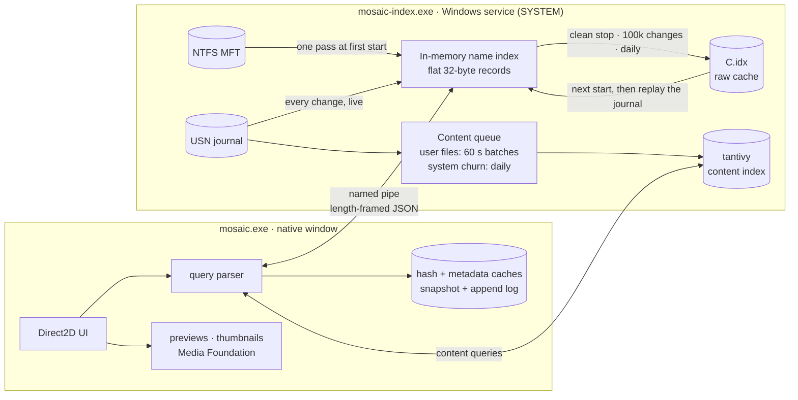

<p align="center">
  
</p>

<p align="center">
  
  
  
  
</p>

<p align="center">
  <b>Mosaic</b> reads your NTFS drives straight from the Master File Table, keeps up with every change through the<br>
  USN journal, and answers searches across <b>millions of files in milliseconds</b>, from a native window with no web view and no Electron.
</p>

<p align="center">
  <a href="#-features">Features</a> ·
  <a href="#-search-language">Search language</a> ·
  <a href="#-how-it-works">How it works</a> ·
  <a href="#-install">Install</a> ·
  <a href="#-build-from-source">Build</a>
</p>

---

## ⚡ By the numbers

Measured on a Windows 11 PC with a 1 TB NVMe system drive. The times are median round trips to the index service.

| | |
|---:|:---|
| **2,541,861** | files and folders indexed on one drive |
| **≈ 12 ms** | to search and rank all of them for a new query (`win`, folders first) |
| **0.3 ms** | to fetch the next page of results |
| **0.14 ms** | for a status round trip over the named pipe |
| **0** | rescans after startup: changes stream in from the USN journal |

<p align="center">
  
  <br><sub><i>Illustration with sample files</i></sub>
</p>

## ✨ Features

<table>
<tr>
<td width="50%" valign="top">

### 🔎 Search like Everything, then some
- **Instant filename search** across every NTFS volume, live as files change
- Everything-style syntax: `|` OR, `!` NOT, `( )` groups, `"phrases"`, `*` `?` wildcards
- **Regex**, **match case**, **whole word**, **ignore diacritics**, each on one key
- Filters for type, size, dates, attributes, path, folder relations and duplicates
- **Type words**: search `pictures` or `music` and match by file type

</td>
<td width="50%" valign="top">

### 📄 Full-text content search
- Searches **inside** text, code, Office (`docx` `xlsx` `pptx` `odt`…), **PDF** and legacy Office (via Windows IFilters)
- Powered by [tantivy](https://github.com/quickwit-oss/tantivy), indexed in the background at low priority
- Text and Office files you just saved are searchable **immediately**: one still waiting for indexing is read live at query time
- System and app churn (Windows, ProgramData, AppData) is batched once a day to spare your SSD

</td>
</tr>
<tr>
<td valign="top">

### 🗂️ A real file explorer
- **Home** works like Explorer's Quick access; **All** shows everything; plus Gallery, This PC and the usual folders
- Folders and shortcuts open **inside Mosaic**, with back/forward history and mouse side buttons
- List or **thumbnail grid** view; folders full of photos or music get the matching icon
- Hidden-file toggle, faded hidden items, shortcut arrows, drag and drop, the shell context menu
- Open a **terminal** (PowerShell or cmd, optionally as admin) right where you are

</td>
<td valign="top">

### 🖼️ Preview everything
- Images (HEIC, AVIF, WebP, PSD, JXR…), animated **GIFs**, **video** (incl. AV1) and **audio** through Media Foundation
- Text and code, folder previews, rich metadata (dimensions, duration, camera…)
- **Metadata search**: `camera-model:`, `artist:`, `iso-speed:`, `width:`, `height:`
- **Hash search and duplicate finder**: `md5:` `sha1:` `sha256:` `crc32:` `dupe:`

</td>
</tr>
<tr>
<td valign="top">

### 🪶 Light on your machine
- A native Win32 + Direct2D/DirectWrite window: no browser engine inside
- Index records are flat 32-byte structs; the on-disk cache is a raw dump that loads in one read
- Parallel ranking with [rayon](https://github.com/rayon-rs/rayon), SIMD substring search with `memchr`

</td>
<td valign="top">

### 💾 Kind to your SSD
- The name cache is rewritten only on a clean stop, after 100k changes or once a day, never on a timer
- Hash and metadata caches **append** small change logs instead of rewriting megabytes
- Content index commits are batched; a file saved over and over is re-indexed at most every 6 h

</td>
</tr>
</table>

🌍 **17 languages**: English, Español, العربية, Português, Français, Kiswahili, Hausa, हिन्दी, 中文, Русский, Yorùbá, Igbo, አማርኛ, isiZulu, Soomaali, Wolof, Afaan Oromoo. Dark and light themes.

## 🧠 Search language

Space means **AND**. Everything below can be combined, grouped and negated.

| Operator | Example | Meaning |
|---|---|---|
| `a b` | `report 2026` | both words |
| `a \| b` | `jpg \| png` | either |
| `!a` | `report !draft` | not |
| `( )` | `invoice (pdf \| docx)` | grouping |
| `"…"` | `"Program Files (x86)"` | exact phrase, operators included |
| `*` `?` | `IMG_????.jpg` | wildcards |

| Function | Examples |
|---|---|
| `ext:` | `ext:pdf` · `ext:jpg;png;gif` |
| `size:` | `size:>100mb` · `size:<=4kb` · `size:1mb..1gb` |
| `dm:` `dc:` `da:` <sub>modified · created · accessed</sub> | `dm:today` · `dm:lastweek` · `dc:2026-01` · `dm:2026-01-01..2026-06-30` · `da:>=2025` |
| `file:` `folder:` | `folder: node_modules` |
| `path:` | `path:\projects\ ext:rs` |
| `attrib:` | `attrib:h` (hidden) · `attrib:rs` (read-only + system) · `attrib:e` (encrypted) |
| `parent:` `child:` `sibling:` `ancestor:` `descendant:` | `child:"C:\Users\you\Desktop"` · `descendant:D:\photos ext:raw` |
| `empty:` `exists:` | `folder: empty:` |
| `distinct:` `unique:` | `distinct:name` · `unique:size` |
| `md5:` `sha1:` `sha256:` `crc32:` | `sha256:9f86d081…` |
| `dupe:` | `dupe: ext:mp4` (files with an identical twin) |
| `camera-model:` `artist:` `iso-speed:` `width:` `height:` | `width:>=3840` · `camera-model:x100` |

Date words: `today` `yesterday` `thisweek` `lastweek` `thismonth` `lastmonth` `thisyear` `lastyear`, or `YYYY[-MM[-DD]]` with `>` `>=` `<` `<=` `=` and `A..B` ranges.
Typing a bare path such as `C:\Users\you\Downloads` lists what's under it.
Flip the **Content** toggle to search inside files, or **Tags** to match embedded metadata.

### ⌨️ Keys

| | | | |
|---|---|---|---|
| <kbd>Alt</kbd>+<kbd>M</kbd> match case | <kbd>Alt</kbd>+<kbd>W</kbd> whole word | <kbd>Alt</kbd>+<kbd>E</kbd> regex | <kbd>Alt</kbd>+<kbd>D</kbd> ignore diacritics |
| <kbd>Alt</kbd>+<kbd>P</kbd> preview pane | <kbd>Alt</kbd>+<kbd>B</kbd> sidebar | <kbd>Alt</kbd>+<kbd>←</kbd> / <kbd>→</kbd> back / forward | <kbd>Alt</kbd>+<kbd>↑</kbd> parent folder |
| <kbd>Alt</kbd>+<kbd>T</kbd> track created/accessed dates | | | |

## 🏗️ How it works



- **No crawling.** The service reads the MFT once, then follows the USN journal. After a restart it loads its cache and replays the journal from where it stopped instead of rescanning the drive.
- **Unprivileged UI.** Only the small service runs elevated. The window talks to it over an ACL-protected named pipe.
- **Ranking is cheap.** Records are tiny and contiguous: sorting by name, size or date is a parallel pass over flat arrays, and folders-first touches only the matches.
- **Search is never stale.** The content index reloads its reader on every query, and files changed since the last batch are read and matched on the spot.

## 📦 Install

1. Get **`MosaicSetup.exe`**: [build it](#-build-from-source) with one command.
2. Run it and pick an **icon preset**: 11 color themes, each in two styles.
3. Accept the one admin prompt. It installs the background index service that reads the file table.
4. Type. Name search is ready once the drive is read; content indexing then continues quietly in the background.

## 🛠️ Build from source

Requires **Rust** (stable, MSVC toolchain) and **[Inno Setup 6](https://jrsoftware.org/isinfo.php)**. [ImageMagick](https://imagemagick.org) is only needed to re-render the icon presets.

```powershell
git clone https://github.com/FrCynda/mosaic-search.git
cd mosaic-search
.\build.ps1                                    # release build + installer -> dist\MosaicSetup.exe
cargo test --release --bin mosaic-wrapper      # the test suite
.\tools\gen-presets.ps1                        # optional: re-render icons/presets from icons/presets-src/*.svg
```

<details>
<summary><b>Project layout</b></summary>

```
src/
├─ application/        search engine: query parser, index, ranking, catalog
├─ infrastructure/
│  ├─ ntfs/            MFT reader, USN journal watcher
│  ├─ service/         Windows service host, SCM, named-pipe server/client
│  └─ indexing.rs      volume indexing, cache persistence
├─ contentindex.rs     tantivy full-text index and its live/daily batching
├─ extract.rs          text extraction: plain text, Office XML, IFilters
├─ hashcache.rs        md5/sha1/sha256/crc32 + duplicate finder
├─ metadata.rs         shell property metadata (camera, artist, dimensions…)
├─ kvlog.rs            snapshot + append-only log persistence
├─ native*.rs          the Win32 / Direct2D window, sidebar, previews
├─ shell.rs            shell integration: icons, context menu, shortcuts, terminals
└─ i18n.rs             17 UI languages
installer/             Inno Setup script
icons/                 app icons and presets
```

</details>

## 🙏 Credits

The NTFS engine (`application/`, `infrastructure/`) is adapted from **AllTheThings** (MIT).
Full-text search by **[tantivy](https://github.com/quickwit-oss/tantivy)**. Inspired by the legendary **[Everything](https://www.voidtools.com)** by voidtools.
See [THIRD-PARTY-NOTICES.md](THIRD-PARTY-NOTICES.md) for all licenses.

<p align="center"><sub>Made with Rust, for people with too many files.</sub></p>
